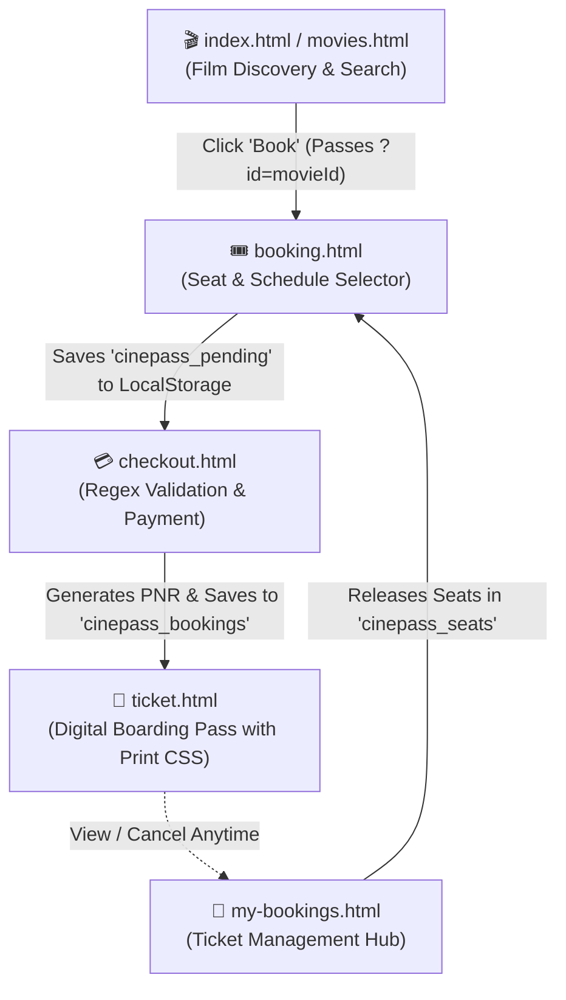

<div align="center">

  
  <br/>
  

  # CinePass

  **A modern, responsive cinema discovery and movie ticket booking web application.**  
  *Engineered with semantic HTML5, CSS3 Grid & Flexbox layouts, and vanilla ES6+ JavaScript.*

  <br/>

  <!-- Tech Stack Animated Badges / GIFs -->
  <p align="center">
    <a href="https://developer.mozilla.org/en-US/docs/Web/HTML">
      
    </a>
    &nbsp;&nbsp;&nbsp;&nbsp;
    <a href="https://developer.mozilla.org/en-US/docs/Web/CSS">
      
    </a>
    &nbsp;&nbsp;&nbsp;&nbsp;
    <a href="https://developer.mozilla.org/en-US/docs/Web/JavaScript">
      
    </a>
    &nbsp;&nbsp;&nbsp;&nbsp;
    <a href="https://code.visualstudio.com/">
      
    </a>
  </p>

  <p align="center">
    
  </p>

  <p align="center">
    
    
    
    
  </p>

</div>

---

## 📽 Overview

**CinePass** is a high-performance cinema ticketing web portal designed to provide a fast, distraction-free movie discovery and booking workflow. Unlike bloated commercial platforms cluttered with ad banners and aggressive upselling, CinePass focuses on core web standards:

- **Zero Framework Overhead**: Built purely on native browser APIs with zero external dependencies (no React, Bootstrap, or jQuery).
- **Persistent State Without a Backend**: Utilizes the browser's native `localStorage` to manage pending reservations, occupied seats, and confirmed ticket history across sessions.
- **Dynamic 60-Seat Auditorium**: Interactive seat visualizer featuring tiered pricing (Silver, Gold, Platinum), seat selection safety caps (max 8 seats), and real-time total recalculation.
- **Boarding-Pass Digital Ticket**: Generates verified 8-character PNR codes (`CPXXXXXX`) with `@media print` stylesheets optimized for physical paper ticket printing.

---

## 🚀 Key Features

### 1. Dynamic Catalogue & Real-Time Search
- **Instant Client-Side Filtering**: Filters 150+ film records dynamically on `input` events without page reloads.
- **Multi-Category Browsing**: Dedicated listings for Bollywood, Hollywood, Regional Indian cinema, and Anime titles (`movies.html` & `anime.html`).
- **Defensive Poster Fallback**: Integrated SVG fallback generation preventing broken UI layouts on slow network connections.

### 2. Interactive Seat Reservation (`booking.html`)
- **60-Seat Interactive Grid**: Visualizes auditorium rows (A through F) with 10 seats per row.
- **Tier-Based Pricing**:
  - `Silver Tier` (Rows A–B): ₹200
  - `Gold Tier` (Rows C–D): ₹280
  - `Platinum Tier` (Rows E–F): ₹350
- **Deterministic Seeded Occupancy**: Employs a mathematical hash algorithm (`getSeededSeats()`) to generate realistic ~22% occupancy per showtime without a backend database.

### 3. Regex-Validated Checkout (`checkout.html`)
- **Strict Regular Expression Verification**:
  - **Mobile Number**: `^[0-9]{10}$` (exact 10 numeric digits)
  - **Email Address**: `^[^\s@]+@[^\s@]+\.[a-zA-Z]{2,}$`
  - **Payment Validation**: Card (16-digit + MM/YY expiry), UPI ID, and Netbanking support.

### 4. Digital Boarding Pass & Management Hub (`ticket.html` & `my-bookings.html`)
- **Printable Boarding Pass**: Boarding-pass format ticket rendering film metadata, screen timing, seat allocations, and barcode visuals.
- **Booking Hub & Cancellation**: Users can inspect active reservations and cancel tickets, instantly releasing reserved seats back into the available pool.

---

## 🏗 Application Architecture & Data Flow



---

## 🛠 Tech Stack

| Technology | Role in CinePass |
|---|---|
|  **HTML5** | Semantic structure (`<header>`, `<nav>`, `<main>`, `<section>`, `<article>`, `<footer>`), accessible form controls, and meta tags. |
|  **CSS3** | CSS Custom Properties (variables), CSS Grid (catalogue & seat visualizer), Flexbox, and Media Queries (`900px`, `640px`). |
|  **JavaScript (ES6+)** | Pure client-side logic, DOM manipulation (`createElement`, `textContent`), array operations (`filter`, `map`, `reduce`), and event listeners. |
|  **Web Storage API** | Browser `localStorage` persistence for pending selections (`cinepass_pending`), bookings (`cinepass_bookings`), and seat locks (`cinepass_seats`). |
|  **Visual Studio Code** | Primary development environment with Live Server for local testing and debugging. |

---

## 📂 Project Directory Structure

```
Web-dev End Sem Project/
├── index.html            # Landing page with hero banner, statistics, and now showing showcase
├── movies.html           # Comprehensive movie catalogue with live search and category chips
├── anime.html            # Dedicated Japanese anime film collection
├── booking.html          # Interactive 60-seat auditorium visualizer and schedule selector
├── checkout.html         # Validated payment form with regular expression guards
├── ticket.html           # Digital cinema ticket with verified PNR and print trigger
├── my-bookings.html      # Central reservation hub with ticket view and cancellation options
├── about.html            # Project overview and interactive contact form
├── css/
│   └── style.css         # Unified design system, CSS variables, and responsive layout rules
├── js/
│   ├── data.js           # Mock movie database, storage helpers, and seeded seat hashing algorithm
│   ├── site.js           # Header scroll interactions, sticky navigation, and badge counters
│   ├── home.js           # Dynamic homepage showcase rendering and ticker animation
│   ├── catalogue.js      # Real-time search, category filtering, and sorting engine
│   ├── booking.js        # Seat selection visualizer, tier pricing, and max seat limits
│   ├── checkout.js       # Form validation logic, input masking, and PNR generator
│   ├── ticket.js         # URL parameter routing and printable boarding pass renderer
│   ├── bookings.js       # Booking history management and cancellation handling
│   └── posters.js        # Fallback image mapping
└── images/
    ├── logo.png          # CinePass brand insignia
    ├── favicon.png       # CinePass site icon
    └── posters/          # High-resolution film poster assets
```

---

## ⚡ Quick Start

No Node.js, npm, or build tools required. CinePass runs directly in any modern web browser:

1. **Clone the repository:**
   ```bash
   git clone https://github.com/ishangupta1412/CinePass.git
   cd CinePass
   ```

2. **Open in browser:**
   - Double-click `index.html` to open directly, **OR**
   - In **VS Code**, right-click `index.html` and select **"Open with Live Server"**.

---

## 👥 Engineering Team

Developed for the **Web Development Course (2026FSWD100)** at the **School of Computer Science Engineering and Technology, Bennett University**:

- **Ishan Gupta** (`S26CSEU1496`) — *Frontend Core Architecture, Design System Tokens & Ticket Engine*
- **Aditya Kumar Gour** (`S26CSEU1510`) — *Catalogue Engine, Real-Time Search & Multimedia Curation*
- **Ojas Tomar** (`S26CSEU1500`) — *Interactive Seat Visualizer, Regex Form Validation & Storage Persistence*

**Course Faculty:** Mr. Manish Kumar

---

## 📄 License

This project is open-source under the [MIT License](LICENSE).
