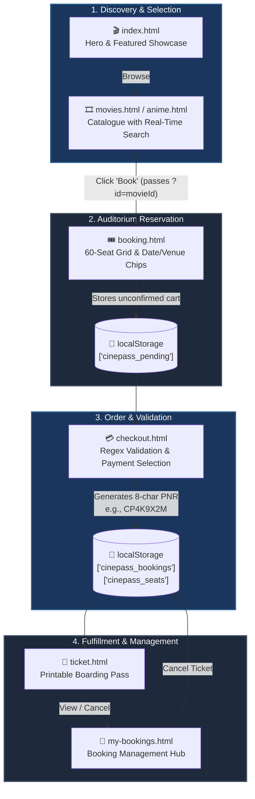

<div align="center">


# CinePass

### A Modern Cinema Discovery & Interactive Ticket Reservation Web Portal
*Pure client-side cinema booking application engineered with semantic HTML5, modern CSS3 layout systems (Grid & Flexbox), and modular vanilla JavaScript (ES6+). Features instant catalogue filtering, interactive 60-seat auditorium visualizer with tiered pricing, regex-validated checkout, and printable boarding passes.*

<br/>

[](https://developer.mozilla.org/en-US/docs/Web/HTML)
[](https://developer.mozilla.org/en-US/docs/Web/CSS)
[](https://developer.mozilla.org/en-US/docs/Web/JavaScript)
[-10b981.svg?style=flat-square&logo=googlechrome&logoColor=white)](https://developer.mozilla.org/en-US/docs/Web/API/Window/localStorage)
[](https://code.visualstudio.com/)
[](./LICENSE)

<br/>

<a href="https://skillicons.dev">
  
</a>

<br/><br/>

[**Overview**](#overview) &nbsp;•&nbsp; 
[**Engineering Pillars**](#engineering-pillars) &nbsp;•&nbsp; 
[**System Architecture**](#system-architecture--data-flow) &nbsp;•&nbsp; 
[**Test Suite**](#functional-verification-suite) &nbsp;•&nbsp; 
[**Project Structure**](#project-structure) &nbsp;•&nbsp; 
[**Quickstart**](#quickstart--local-setup) &nbsp;•&nbsp; 
[**Engineering Team**](#engineering-team)

</div>

---

## Overview

Commercial movie ticketing platforms suffer from severe design bloat: heavy third-party tracking scripts, intrusive advertisement banners, aggressive snack upselling dialogues, and multi-megabyte bundle sizes that stutter on mobile networks. 

**CinePass** addresses this challenge by delivering a distraction-free, high-performance cinema booking experience built exclusively with foundational client-side web technologies:
1. **Zero External Frameworks**: No React, Bootstrap, Tailwind, or jQuery. Native DOM manipulation and vanilla CSS guarantee immediate page execution.
2. **Persistent State Without a Backend**: Employs the browser's native **Web Storage API (`localStorage`)** to manage transient checkout states, seat occupancy maps, and permanent confirmed ticket ledgers across browser sessions.
3. **Interactive 60-Seat Auditorium Grid**: Dynamic SVG/CSS seat visualizer supporting tiered seating categories (Silver, Gold, Platinum) with real-time price recalculation and strict safety limits (max 8 seats per booking).
4. **Deterministic Seeded Occupancy**: Generates realistic, reproducible seat occupancy (~22% occupied per showtime) using a client-side polynomial string hashing algorithm without a dedicated database server.
5. **Print-Optimized Boarding Pass**: Boarding-pass format ticket rendering verified 8-character PNR codes (`CPXXXXXX`) with `@media print` rules for physical printing.

---

## Engineering Pillars

### 1. Dynamic Catalogue & Real-Time Dual-State Search
- **Instant Search Filter**: Attaches `input` event listeners across the 150+ film dataset in `data.js`. Filters titles dynamically using `Array.prototype.filter()` and substring matching without page reloads.
- **Dual-State Category Logic**: Evaluates genre chips (`All`, `Action`, `Drama`, `Sci-Fi`) and language filters (`Hindi`, `English`, `Telugu`, `Tamil`, `Japanese`) concurrently:
  $$\text{Visible}(m) = \Big(\text{query} \subseteq m.\text{title}\Big) \;\land\; \Big(m.\text{genre} \cap \text{activeGenre} \neq \emptyset\Big) \;\land\; \Big(m.\text{lang} = \text{activeLang}\Big)$$
- **Defensive Image Fallback**: Integrated SVG poster generators ensure that network timeouts or missing remote assets never break the catalogue grid.

### 2. 60-Seat Interactive Auditorium Visualizer
- **Two-Dimensional Grid Architecture**: The auditorium is structured into 6 rows ($A$ to $F$) with 10 seats per row (60 total seats):
  - **Silver Tier** (Rows A–B): Base admission ₹200
  - **Gold Tier** (Rows C–D): Mid-tier admission ₹280
  - **Platinum Tier** (Rows E–F): Premium lounger admission ₹350
- **Seat Safety Envelopes**: Prevents race conditions and bulk hoarding by enforcing $1 \le \text{seats} \le 8$. Exceeding the 8-seat limit blocks selection and triggers immediate feedback.
- **Real-Time Price Recalculation**: Computes order total via `Array.prototype.reduce()` on active seat state:
  $$\text{Subtotal} = \sum_{s \,\in\, \text{Selected}} \text{TierPrice}(s.\text{tier})$$

### 3. Deterministic Seeded Seat Hashing Engine
To provide a realistic cinema atmosphere where various seats are already occupied without connecting to a remote SQL database, CinePass implements a polynomial string hash algorithm:
```javascript
function hashString(text) {
  let hash = 0;
  for (let i = 0; i < text.length; i++) {
    hash = (hash * 31 + text.charCodeAt(i)) % 1000003;
  }
  return hash;
}
```
For any given show key ($\text{MovieID} \mathbin{::} \text{Date} \mathbin{::} \text{Theatre} \mathbin{::} \text{Time}$), each seat ID is hashed:
$$\text{IsOccupied}(\text{seatId}) = \Big(\text{hashString}(\text{ShowKey} \mathbin{::} \text{seatId}) \pmod{100} < 22\Big)$$
This ensures realistic, persistent occupancy distributions for every unique cinema showtime.

### 4. Regular Expression Form Validation
Client-side form submissions are protected with strict regex patterns before any booking can be committed to storage:
- **Mobile Number Validation**: `/^[0-9]{10}$/` (exact 10 numeric digits, preventing characters, prefixes, or spaces).
- **Email Address Validation**: `/^[^\s@]+@[^\s@]+\.[a-zA-Z]{2,}$/` (RFC 5322 compliant syntax).
- **Card Expiry Date**: `/^(0[1-9]|1[0-2])\/[0-9]{2}$/` (enforces valid month 01–12 and 2-digit year).
- **Card Number**: Validates 16 numeric digits with cardholder identity verification.

### 5. Multi-Session Web Storage Architecture
State persistence is partitioned across three distinct `localStorage` keys:
- `cinepass_pending`: Ephemeral JSON object holding unconfirmed selections during checkout navigation.
- `cinepass_bookings`: Persistent array containing all confirmed booking ledgers (PNR, movie details, seats, customer identity, payment mode, timestamps).
- `cinepass_seats`: Global occupancy map recording user-confirmed seat locks across venues. Ticket cancellation frees seats immediately by removing keys from this map.

---

## System Architecture & Data Flow



---

## Functional Verification Suite

| Test ID | User Action / Input | Expected System Behavior | Verification Status |
| :--- | :--- | :--- | :---: |
| **TC-01** | Open `index.html` in browser | Sticky header, hero banner, statistics counters, and now-showing rows render cleanly. | `PASS` |
| **TC-02** | Search `dhurandhar` in `movies.html` | Catalogue grid filters instantaneously on keypress to display matching title. | `PASS` |
| **TC-03** | Apply `Telugu` language chip | Filters catalogue to regional Telugu titles; results counter updates synchronously. | `PASS` |
| **TC-04** | Select date & time in `booking.html` | Active chips highlight; seat visualizer recalculates deterministic occupancy map. | `PASS` |
| **TC-05** | Select $> 8$ seats in auditorium | 9th seat selection is intercepted and blocked; error toast feedback triggers. | `PASS` |
| **TC-06** | Submit checkout with invalid phone/email | Form submission is halted; offending fields highlight red with assistive error labels. | `PASS` |
| **TC-07** | Complete valid payment transaction | Unique 8-char PNR is minted; user is routed to `ticket.html` with confirmed pass. | `PASS` |
| **TC-08** | Click `Cancel` in `my-bookings.html` | Booking ledger record is deleted; occupied seats are instantly released back to pool. | `PASS` |

---

## Project Structure

```
CinePass/
├── index.html            # Landing portal with hero showcase, statistics, and movie rows
├── movies.html           # Comprehensive cinema catalogue with live search & genre chips
├── anime.html            # Dedicated Japanese animation catalogue
├── booking.html          # Interactive 60-seat auditorium visualizer and schedule selector
├── checkout.html         # Validated payment form protected by regular expression guards
├── ticket.html           # Digital cinema ticket with verified PNR and print trigger
├── my-bookings.html      # Central reservation hub with ticket view and cancellation options
├── about.html            # Project documentation and interactive contact form
├── css/
│   └── style.css         # Design system tokens, CSS Grid rules, and responsive media queries
├── js/
│   ├── data.js           # Mock movie database, storage helpers, and seeded seat hashing algorithm
│   ├── site.js           # Header scroll interactions, sticky navigation, and badge counters
│   ├── home.js           # Dynamic homepage showcase rendering and marquee ticker animation
│   ├── catalogue.js      # Real-time search, category filtering, and sorting engine
│   ├── booking.js        # Seat selection visualizer, tier pricing, and max seat limits
│   ├── checkout.js       # Form validation logic, input masking, and PNR generator
│   ├── ticket.js         # URL parameter routing and printable boarding pass renderer
│   ├── bookings.js       # Booking history management and cancellation handling
│   └── posters.js        # Fallback image mapping
└── images/
    ├── logo.png          # CinePass brand insignia
    ├── favicon.png       # CinePass site icon
    └── posters/          # High-resolution film poster assets
```

---

## Quickstart & Local Setup

CinePass requires no Node.js runtime, build steps, or dependency installations:

1. **Clone the repository:**
   ```bash
   git clone https://github.com/ishangupta1412/CinePass.git
   cd CinePass
   ```

2. **Launch the application:**
   - Double-click `index.html` to open directly in any web browser, **OR**
   - In **VS Code**, right-click `index.html` and choose **"Open with Live Server"**.

---

## Engineering Team

Developed for the **Web Development Course (2026FSWD100)** at the **School of Computer Science Engineering and Technology, Bennett University**:

- **Ishan Gupta** (`S26CSEU1496`) — *Frontend Core Architecture, Design System Tokens & Ticket Engine*
- **Aditya Kumar Gour** (`S26CSEU1510`) — *Catalogue Engine, Real-Time Search & Multimedia Curation*
- **Ojas Tomar** (`S26CSEU1500`) — *Interactive Seat Visualizer, Regex Form Validation & Storage Persistence*

**Course Faculty:** Mr. Manish Kumar

---

## License

This project is licensed under the [MIT License](LICENSE).
